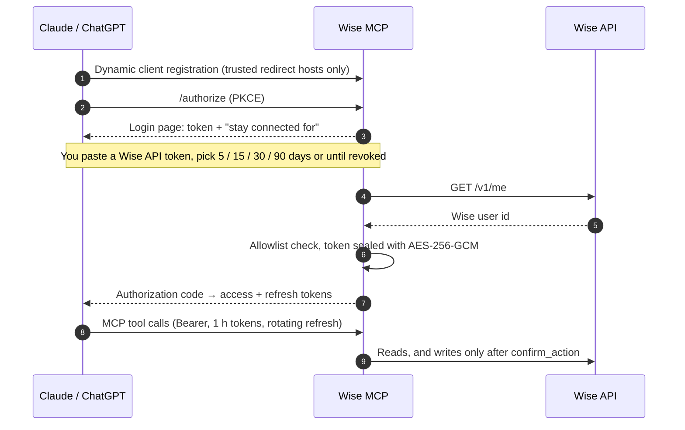

<div align="center">


# Wise MCP

**Ask Claude or ChatGPT about your Wise money.**
The simplest, most complete MCP server for your Wise balances, card payments, transfers and recipients that can also prepare transfers you approve twice.
Run it locally with one `npx` command (Claude Desktop, Claude Code, Codex, Cursor…), or host it as a custom connector for Claude and ChatGPT.


</div>

---

> **Personal fork — deployment status:** This fork defaults to **9 informational tools**, including two temporary-quote endpoints; five account-changing tools require explicit opt-in. It is **not yet connected to a real Wise account or installed in Executor CLI**. Wise currently documents personal API tokens chiefly for Wise Business accounts, with limited permitted endpoints. Availability for this account and region must be tested. See [France/EU personal-account diagnostics](FRANCE-PERSONAL-TEST.md), [deployment checklist](OPERATIONS.md), [Beelink setup](scripts/windows/README.md), and [MacBook / Executor CLI setup](scripts/macos/README.md).

> *"How much did I spend on groceries in September?"*
> *"What's left in my jars, in EUR?"*
> *"Show the transfers I sent to Mario this year and the rate I got."*
> *"Send Mario 120 EUR for dinner."*

Give it a Wise API token once and your assistant can answer questions like these across all your Wise profiles, personal and business. It can also prepare transfers, new recipients and cancellations. Every change needs your explicit approval in chat, and a transfer only moves money once **you pay it in the Wise app**.

### Why this one

The simplest way to connect Wise to an AI assistant, and the most feature-rich Wise MCP server we know of (October 2026):

- **One token, no partner account.** Other servers need Wise partner OAuth credentials or stop at read-only basics. Here a personal API token is all you need, locally or hosted.
- **Your real spending.** The activity feed includes **card payments** with clean merchant names and amounts, plus transfers, conversions, cashback and Jars, across personal and business profiles.
- **Writes you can trust.** Quotes, new recipients, transfers and cancellations, all two-step and approved in chat; transfers are paid by you in the Wise app.
- **Everywhere.** `npx` for Claude Desktop, Claude Code, Codex and Cursor, a one-click Claude Desktop extension, or a self-hosted connector for Claude and ChatGPT on web and mobile.
- **Built for real accounts.** 14 tools, encrypted token storage, session management, an audit log, and end-to-end tests for both modes.

## Choose how to run it

| | **Local** | **Remote (self-hosted)** |
| --- | --- | --- |
| Works with | Claude Desktop, Claude Code, Codex, Cursor, VS Code, any MCP client | Claude (web, desktop, mobile) and ChatGPT custom connectors |
| Setup | One `npx` command or a one-click Claude Desktop extension | Deploy a container behind HTTPS (Dokploy, Easypanel, Docker Compose) |
| Token | In your app's MCP config, on your machine | Pasted on a login page, stored encrypted on your server |
| Guide | [Run locally](#run-locally) | [Deploy](#deploy) |

## Contents

- [Why this one](#why-this-one)
- [Choose how to run it](#choose-how-to-run-it)
- [Tools](#tools)
- [How it works](#how-it-works)
- [Security model](#security-model)
- [Run locally](#run-locally)
- [Deploy](#deploy)
- [Your server's pages](#your-servers-pages)
- [Configuration](#configuration)
- [Development](#development)
- [Limitations](#limitations)
- [Contributing](#contributing)
- [License](#license)

## Tools

### Read

| Tool | What it returns |
| --- | --- |
| `list_profiles` | Every Wise profile the token can see (personal, business) |
| `list_balances` | Balances in every currency plus **Jars**, across all profiles by default |
| `get_transactions` | Activity feed, newest first: **card payments**, transfers, conversions, cashback, direct debits. Clean merchant names, numeric amounts, `in` / `out` / `neutral` direction. Filter by type, status, date range and text; cursor pagination |
| `list_transfers` | Transfers newest first, with both currencies, reference, status and recipient name |
| `get_transfer` | One transfer in detail: rate, amounts, reference, recipient |
| `list_recipients` | Saved recipients with account number / IBAN, filterable by currency and text |
| `get_exchange_rate` | Wise mid-market rate, now or at a past date |

### Informational estimates (available by default)

| Tool | What it does |
| --- | --- |
| `get_quote` | Prices a transfer or conversion without creating a transfer or moving money. Creates a temporary Wise quote via POST, which may require more than a read-only Wise token |
| `get_recipient_requirements` | Retrieves recipient field requirements using a temporary Wise quote. Does not add a recipient; may require quote API permission |
### Account-changing actions (disabled by default; opt in with `WRITES_ENABLED=true`)

| Tool | What it does |
| --- | --- |
| `prepare_transfer` | Quotes a transfer to a saved recipient, checks Wise's route requirements and your balance, returns a summary + one-time code |
| `prepare_recipient` | Validates a new recipient and returns a summary + one-time code |
| `prepare_cancel_transfer` | Prepares cancelling a transfer you haven't paid yet |
| `confirm_action` | Performs a prepared action. Only after you approve the exact summary |
| `discard_action` | Throws a prepared action away |

Profiles are discovered from the token at runtime. Every tool takes an optional `profile`: an id, `personal`, `business`, or part of the profile name.

## How it works

**Locally**, the server runs on your machine as a child process of your MCP client and reads the token from `WISE_API_TOKEN`. Nothing is hosted and there's no login.

**Remotely**, Wise doesn't offer OAuth to individuals, so the server is its own OAuth 2.1 authorization server for Claude and ChatGPT, and the "login" is a Wise personal API token you paste once.



- **Session length** is chosen at each login. Access tokens last one hour; refresh tokens rotate on every use and live exactly as long as the session.
- **`/sessions`** lists every connected session for your Wise account and lets you revoke one or all. You sign in by pasting a Wise token again; it's only used to check who you are and is never stored. Access lasts 15 minutes in an HTTP-only cookie.
- **Revoking in Wise works too**: delete the token in Wise → Settings → API tokens. The next call fails with a clear message, and the server deletes the stored token and every session that used it.

### Two confirmations for every write

```
prepare_*  ──▶  summary + code (TX-…, RCP-…, CXL-…)  ──▶  you approve in chat  ──▶  confirm_action
                 nothing written to Wise yet              ①                          created in Wise
                                                                                          │
transfers only:                                    you pay it in the Wise app  ◀──────────┘
                                                   ②  money moves only now
```

- Codes are single-use, expire after 10 minutes, and only work from the session that prepared them.
- Transfers are created **unpaid** (`incoming_payment_waiting`). Wise doesn't let personal tokens fund transfers for EU/UK accounts anyway, so the final "Pay" is always yours. Until then you can cancel the transfer with `prepare_cancel_transfer` or in the app.
- Prepare, confirm, discard and failure events are logged with limited identifiers, not recipient bank details, free-text summaries or confirmation codes (`~/.wise-mcp/` locally, the data volume when hosted).

## Security model

| | |
| --- | --- |
| ✋ **Two-step writes** | Every write is prepare → your approval in chat → confirm with a one-time code. Transfers then also need you to pay them in the Wise app. |
| 🔒 **Read-only option** | Safe mode by default (9 tools, including two informational calls that create temporary quotes); `WRITES_ENABLED=true` explicitly enables 5 additional account-changing tools. With a Wise **Read only** token, write tools fail with a clear message and reading keeps working. |
| 💶 **Limits** | Optional `MAX_TRANSFER_AMOUNT` per transfer. Wise's own route checks (purpose, source of funds) are enforced before a code is issued. |
| 🧾 **Allowlist** | Only Wise user ids in `ALLOWED_WISE_USERS` can connect. Any other token is refused and nothing about it is stored. Removing an id cuts off that user's existing sessions too. |
| 🗝️ **Encryption at rest** | Wise tokens are sealed with AES-256-GCM under `TOKEN_ENCRYPTION_KEY`. OAuth tokens are stored only as SHA-256 hashes. State files and the audit log use private Unix permissions and restricted Windows ACLs. |
| 🧹 **Minimal retention** | A Wise token is deleted as soon as no live session uses it: after revocation, session expiry, or when Wise rejects it. |
| 🔁 **OAuth hardening** | PKCE (S256), single-use login and authorization codes, rotating refresh tokens, redirect hosts limited to `claude.ai`, `claude.com`, `chatgpt.com` and localhost, so authorization codes can only reach apps you trust. |
| 🚦 **Rate limiting** | The token forms (`/login`, `/sessions/login`) allow 20 attempts per IP every 15 minutes; OAuth endpoints use the MCP SDK's limits. |
| 🔐 **HTTPS only** | The server refuses to start with a non-HTTPS `PUBLIC_URL`, and every page shows a red warning if it's opened over plain HTTP. API requests are pinned to `https://api.wise.com`; only explicitly enabled local tests can use a loopback mock. |
| 🛡️ **Pages** | Strict CSP (`default-src 'none'`, `form-action` limited to the server and the client's own redirect origin), `X-Frame-Options: DENY`, `no-store`, no referrer. |

> [!WARNING]
> Keep `TOKEN_ENCRYPTION_KEY` out of backups of the data volume. Changing it makes stored tokens unreadable: just reconnect.

## Run locally

Needs Node.js 20 or newer. Create a token first: Wise → **Settings → API tokens → Add new token** (**Full access** to prepare transfers and recipients, **Read only** for answers only).

### Claude Desktop extension (one click)

Download `wise-mcp-<version>.mcpb` from the [latest release](https://github.com/BlanketByte/wise-mcp/releases/latest) and open it. Claude Desktop asks for your token (stored securely, never in a plain config file) and whether to allow preparing transfers.

### Claude Code

```bash
claude mcp add wise -e WISE_API_TOKEN=your-token -- npx -y @blanketbyte/wise-mcp
```

### Codex

Add this to `~/.codex/config.toml`:

```toml
[mcp_servers.wise]
command = "npx"
args = ["-y", "@blanketbyte/wise-mcp"]
env = { WISE_API_TOKEN = "your-token" }
```

### Claude Desktop, Cursor, VS Code and other MCP clients

Add this to the client's MCP config (for Claude Desktop: **Settings → Developer → Edit config**):

```json
{
  "mcpServers": {
    "wise": {
      "command": "npx",
      "args": ["-y", "@blanketbyte/wise-mcp"],
      "env": { "WISE_API_TOKEN": "your-token" }
    }
  }
}
```

The repo is also an [Agent Plugin](https://agent-plugins.org) (`plugin.json` + `mcp.json`), so clients and directories that support the standard can install it directly. Set `WISE_API_TOKEN` in your client.

Optional env: `WRITES_ENABLED=true` to enable two-step writes explicitly, `MAX_TRANSFER_AMOUNT` for a per-transfer limit. Run `npx @blanketbyte/wise-mcp --help` for all options.

> [!NOTE]
> ChatGPT only connects to remote servers, so for ChatGPT use the [self-hosted](#deploy) setup.

## Deploy

The container serves plain HTTP on port **3000**; put it behind anything that terminates HTTPS. State (sealed tokens, sessions) lives in **`/data`**.

A prebuilt image is published with every release: **`ghcr.io/blanketbyte/wise-mcp:<version>`** (or `:latest`), for `linux/amd64` and `linux/arm64`. Use it instead of building from source wherever your platform accepts an image.

### Dokploy

1. **DNS**: point a hostname (e.g. `wise.example.com`) at your Dokploy server.
2. **Application**: *Create Service → Application*, source = this repository, branch `main`, build type **Dockerfile**, context `.`.
3. **Domain**: your hostname, container port **3000**, HTTPS on, certificate **Let's Encrypt**.
4. **Volume**: a named volume mounted at **`/data`** (the container runs as uid 1000).
5. **Environment**:
   ```env
   PUBLIC_URL=https://wise.example.com
   ALLOWED_WISE_USERS=          # empty on the first deploy, see step 7
   TOKEN_ENCRYPTION_KEY=        # openssl rand -base64 32
   ```
6. **Deploy**, then check `https://wise.example.com/health`.
7. **Find your Wise user id**: connect from Claude once. The *Not allowed* page shows your id: set `ALLOWED_WISE_USERS=<id>`, redeploy and connect again.

### Easypanel

1. **DNS**: point a hostname (e.g. `wise.example.com`) at your Easypanel server.
2. **Service**: in a project, **+ Service → App**, name it `wise-mcp`.
3. **Source**: **GitHub**, owner/repository of this repo, branch `main`, build path `/`. (Or **Git** with the repository URL.)
4. **Build**: **Dockerfile**, file `Dockerfile`.
5. **Environment**:
   ```env
   PUBLIC_URL=https://wise.example.com
   ALLOWED_WISE_USERS=          # empty on the first deploy, see step 9
   TOKEN_ENCRYPTION_KEY=        # openssl rand -base64 32
   ```
6. **Domains**: add `wise.example.com`, HTTPS on, port **3000**. Easypanel issues the Let's Encrypt certificate.
7. **Mounts**: add a **volume mount** named `data` with mount path **`/data`**. Without it, sessions and tokens are lost on every redeploy.
8. **Deploy**, then check `https://wise.example.com/health`.
9. **Find your Wise user id**: connect once from Claude or ChatGPT. The *Not allowed* page shows your id: set `ALLOWED_WISE_USERS=<id>`, deploy again and reconnect.

To redeploy automatically on every push, enable **Auto Deploy** on the service (it adds a GitHub webhook).

### Docker Compose

```bash
cp .env.example .env            # fill it in
mkdir -p data && sudo chown 1000:1000 data
docker compose up -d --build    # listens on 127.0.0.1:3000
```

### Connect Claude

1. In Wise: **Settings → API tokens → Add new token**. Choose **Full access** to prepare transfers and recipients, or **Read only** if you only want answers.
2. In Claude: **Settings → Connectors → Add custom connector**:
   ```
   https://wise.example.com/mcp
   ```
3. Paste the token, choose how long to stay connected, done.

**ChatGPT:** **Settings → Apps & Connectors**, turn on **Developer mode** (under Advanced), then **Create** a connector with the same `/mcp` address and **OAuth** authentication. The same login page opens.

## Your server's pages

Once deployed, your server has three pages you can open in a browser. Replace `wise.example.com` with your own address.

| Page | Address | What it's for |
| --- | --- | --- |
| 🏠 **Home** | `https://wise.example.com/` | Shows the connector address and step-by-step instructions for Claude and ChatGPT. Open it to check the server is up. |
| 🔑 **Login** | *opens by itself* | Appears when you add the connector in Claude or ChatGPT. Paste your Wise API token, choose how long to stay connected, and press **Connect Wise**. You don't need to open it yourself. |
| 🧾 **Manage sessions** | `https://wise.example.com/sessions` | Lists every app connected to your Wise account (Claude, ChatGPT, on any device) with when it was connected, last used and when it expires. Revoke one, or all at once. To sign in, paste a Wise API token for your account; it's only used to check who you are and is never stored. |

**Common situations**

- *"I want to disconnect a device or app."* Open **Manage sessions** and press **Revoke** next to it.
- *"I think my token leaked."* Delete it in Wise → Settings → API tokens. Every session that used it stops working immediately, and the server deletes its copy. Then reconnect with a new token.
- *"Claude or ChatGPT says to reconnect."* Your session expired or was revoked. Remove and add the connector again; the **Login** page will open.
- *"The login page says Not allowed."* Your Wise account isn't on this server's allowlist. The page shows your Wise user id: add it to `ALLOWED_WISE_USERS` and redeploy.

For monitoring there's also `https://wise.example.com/health`, which returns `{"ok":true}` when the server is running.

## Configuration

| Variable | Mode | Default | |
| --- | --- | --- | --- |
| `WISE_API_TOKEN` | local, **required** | | Wise personal API token |
| `WRITES_ENABLED` | both | `false` | `true` explicitly enables 5 account-changing/preparation tools |
| `MAX_TRANSFER_AMOUNT` | both | *(no limit)* | Max per transfer, in the source currency |
| `DATA_DIR` | both | `~/.wise-mcp` locally, `/data` in Docker | Audit log (and, hosted, sealed tokens and sessions) |
| `PUBLIC_URL` | remote, **required** | | Public HTTPS origin of the server |
| `TOKEN_ENCRYPTION_KEY` | remote, **required** | | ≥ 32 chars; encrypts stored Wise tokens |
| `ALLOWED_WISE_USERS` | remote | *(nobody)* | Comma-separated Wise user ids |
| `ALLOWED_REDIRECT_HOSTS` | remote | `claude.ai,claude.com,chatgpt.com,localhost,127.0.0.1` | Hosts OAuth clients may redirect to |
| `PORT` | remote | `3000` | |

At startup the server logs the allowed users and a short SHA-256 fingerprint of the encryption key, so you can tell which key is deployed without revealing it.

## Development

```bash
npm install
npm run dev         # remote server with tsx watch (needs the remote env vars)
npm test            # typecheck + both end-to-end suites
npm run e2e         # remote server against a local mock of the Wise API
npm run e2e:stdio   # local mode: spawns the CLI like an MCP client would
npm run mcpb        # builds release/wise-mcp-<version>.mcpb
```

The remote end-to-end test boots the server next to a mock Wise API and drives everything Claude does: client registration, PKCE login, allowlist, session lengths, refresh rotation, encryption at rest, every tool (amount parsing, pagination, filters), the two-step writes (single-use codes, cross-session isolation, route requirements, cancellation, audit log, read-only tokens), `/sessions`, and revocation in Wise. The stdio suite covers the CLI, token errors, every tool over stdio, two-step writes, the audit log and read-only mode.

### Releasing

Push a tag matching `package.json` (e.g. `v1.1.0`). The release workflow runs the tests, publishes `@blanketbyte/wise-mcp` to npm with provenance (trusted publishing over GitHub OIDC, no npm token stored anywhere), lists it in the [official MCP Registry](https://registry.modelcontextprotocol.io) from `server.json`, attaches the `.mcpb` to a GitHub release, and pushes the Docker image to `ghcr.io/blanketbyte/wise-mcp`. Before the first release, remove `"private": true` from `package.json`.

<details>
<summary>Project layout</summary>

```
src/
  cli.ts               Entry point: `wise-mcp` (stdio) or `wise-mcp serve` (remote)
  stdio.ts             Local mode over stdin/stdout
  index.ts             Remote server: icons, OAuth routes, /login, /sessions, /mcp
  config.ts            Environment validation (shared and remote-only settings)
  meta.ts              Version, paths, links
  crypto.ts            AES-256-GCM sealing, cookie signing
  tools.ts             MCP tools (read + two-step write)
  pending.ts           Prepared actions and one-time confirmation codes
  wise/client.ts       Wise API client (retries, idempotent transfers, revocation detection)
  wise/service.ts      Profiles, balances, activities, transfers, recipients, rates
  wise/connections.ts  Encrypted per-token connections
  auth/provider.ts     OAuth 2.1 provider for Claude, token-paste login
  auth/store.ts        Clients, sessions, hashed tokens
  auth/pages.ts        Login, /sessions and message pages
public/                Logo, icons, favicon
mcpb/manifest.json     Claude Desktop extension manifest
scripts/e2e.ts         Remote end-to-end test with a mock Wise API
scripts/e2e-stdio.ts   Local (stdio) end-to-end test
scripts/build-mcpb.sh  Builds the .mcpb bundle
.github/workflows/     CI, and release to npm + GitHub
```

</details>

## Limitations

Personal API tokens can't use every Wise endpoint. In particular, for EU/UK accounts PSD2 rules block **balance statements** (so there's no running balance per transaction) and the **card list**. The activity feed covers card payments, so day-to-day spending questions work fine.

On the write side, personal tokens can't **fund** transfers for EU/UK accounts (you pay them in the Wise app, which this server relies on anyway), and Wise rejects API transfers on business accounts that have **payment approval rules**.

## Contributing

Issues and pull requests are welcome; see [CONTRIBUTING.md](CONTRIBUTING.md). Please report security problems privately as described in [SECURITY.md](SECURITY.md).

## License

[MIT](LICENSE) © [BlanketByte](https://blanketbyte.com)

---

<div align="center">

<br>
<sub>Made by <a href="https://blanketbyte.com">BlanketByte</a>. Independent project, not affiliated with or endorsed by Wise.<br>Wise and the Wise flag are trademarks of Wise Payments Limited; the flag is shown unaltered to indicate compatibility.</sub>
</div>
